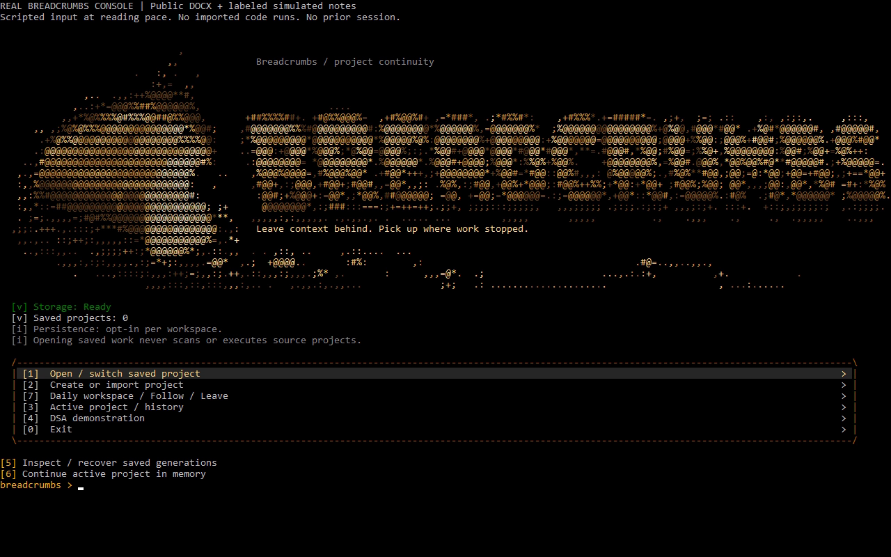

# B7 final implementation and acceptance record

## Result and evidence boundary

B7A–B7E implementation is DEMO_READY for the exercised Windows/JDK25 scope,
targeting Java17. This is not final owner/instructor acceptance or a release.
The complete B1–B6 test bodies remain preserved. Canonical chronology/provenance,
recovery, daily capture/resume, manual Inbox, generated/portable documents and
bounded DOCX capture all run through production CLI/services. No merge, deployment,
Discord update, private-document discovery or package installation occurred.

`REAL_DOCUMENT_ACCEPTANCE = PARTIAL_PUBLIC_DOCX; FULL_MATRIX_PENDING_OWNER_REVIEW`

The owner's additional authorization permitted a substantial public download.
The90,770-byte [Government of Northwest Territories project-plan template](https://www.fin.gov.nt.ca/en/resources/project-management-plan-template)
has453 main-document paragraphs and no Breadcrumbs session. Exact source URL:
https://www.fin.gov.nt.ca/sites/fin/files/project_management_plan.docx.
SHA256: `437972d69ad2e86137e62f9551689ec7247a253dacff83b11ad54645d2ea92c0`.
An independently inspected paragraph154 was captured exactly, explicitly reviewed,
searched, linked to a checkpoint, saved/restarted and rehashed unchanged. Six
public-DOCX assertions passed. Capture is partial at200total claims; field instructions
and cached TOC text are omitted. A template's instructions/placeholder text are
source data, never evidence that the user performed that work.

The [W3C dummy PDF](https://www.w3.org/WAI/ER/tests/xhtml/testfiles/resources/pdf/dummy.pdf)
is13,264bytes, SHA256
`3df79d34abbca99308e79cb94461c1893582604d68329a41fd4bec1885e6adb4`.
It is discovered/fingerprinted only. No PDF body-extraction claim is made. A small
public python-docx paragraph fixture was also checked locally; it does not replace
representative real-document acceptance. Downloaded originals remain under ignored
build folders and are not committed or redistributed as application source.

The public sample does not close actual TXT/Markdown/CSV/XLSX/PPTX/other-format
representative-file gates or owner review. Those formats have synthetic coverage
and truthful metadata boundaries as documented in the compatibility matrix.
No private directory was searched and no real private content was uploaded.

## Final native regression

Command: `pwsh -NoProfile -File scripts/verify-b7-stage.ps1 -Stage B7E -NativeWindows`.
Final accepted run:2026-11-01 05:39:00–05:40:53 Asia/Manila, Windows10,
actual JDK25, Java17 target. Exit0;147 observed source/test/script/launcher input hashes
match before/after. See [summary](evidence/b7/e/summary.txt),
[tests](evidence/b7/e/tests.txt), [inputs](evidence/b7/e/source-sha256.txt) and
[external space-path launcher](evidence/b7/e/launcher.txt). These are LF/trailing
whitespace-normalized review copies; raw logs remain in the named build run.

Observed groups include B1 DLL3721/CLI59; B2 inspector91/bootstrap62/CLI39;
B3 storage65/CLI73/presentation153; B4 187; B5 1090; B6 231; B7A69,
B7B43, B7C47 and B7D58 assertions, plus shared terminal/narrow/privacy checks.
Separate Main-process scenarios pass: B7 four profiles56, B6 21, B5 10 and B4 55,
plus real interrupted-Java recovery. Dynamic output assertions vary with bounded
presentation rows; no old test expectation was weakened. A full aggregate count
is not inferred from partially overlapping runner reports.

The native gate creates real junction fixtures, exercises source/storage/export
guards and existing ACL negatives, plus an unrelated-working-directory launcher
from a runnable folder and storage path containing spaces. Native sharing-lock
tests prove bounded publication recovery/failure. Actual Java17 runtime is absent;
`--release17` on JDK25 is not treated as that execution evidence. Unix, symbolic-link
creation and instructor hardware remain NOT_PROVEN.

## Expected versus observed workflow matrix

| Scenario | Expected | Observed evidence |
| --- | --- | --- |
| A Academic | Import notes/Word/PDF, B0, checkpoint, audit/search/handoff with honest gaps | ACADEMIC Main processes pass; real DOCX parser, PDF metadata negative, generated health/handoff, restart. Public DOCX separately checked. |
| B Software | Explicit dependencies/checkpoint, external change, consented scan, drift/search/resume | SOFTWARE Main processes pass; original source statements stay independently unverified. B6 regression also covers metadata-only source/schema formats. |
| C Operations | CSV/notes, decisions/owners, explicit relationships, nontechnical handoff | OPERATIONS Main processes pass; CSV configured fields and explicit two-item dependency survive restart/package. |
| D Personal/unstructured | Useful without a codebase, manual Inbox and quick checkpoint | NEW_EMPTY production-console test passes capture -> permissions -> manual link -> checkpoint -> package -> restart/search. GENERAL Main runner also passes. |
| E Leave/return | Two checkpoints, saved/generative state and restart agree | Four-profile process runner creates exactly two native checkpoints across processes; read-back canonical count and standalone docs checked. |
| F Interrupted save | Explicit recovery, no silent rollback | Fault seams plus Runtime.halt child process, restart detection, candidate validation and exact recovery acknowledgement pass. |
| G Modified source | Preserve old references, show current hash/freshness | Actual external fixture edit/rescan yields MODIFIED and referenced STALE; old checkpoint observation/IDs remain unchanged. |
| H Search | Exact/prefix, locators, invalidation, isolation, rebuild | Original B6 suites/processes plus Inbox and DOCX tests pass; unsupported-only terms absent; no default snippets/unreviewed verification. |
| I Missing optional libraries | Core operates without document dependencies | All production/process runs use only compiled core/JDK classes. PDF/XLSX/PPTX remain unavailable metadata-only. Actual JDK17 execution remains pending. |
| J Portable handoff | Read standalone, selected archives, no source copies/absolute-root leaks | Artifact and Main tests pass consent/create-only/selected summaries, privacy, read-back and canonical-save/export-failure separation. |

## Terminal, branding and recording

The owner's polished B3 logo is the sole production logo. ReferenceBrandArt remains byte-for-byte unchanged from the accepted B6 baseline.
RichBrandRenderer buffers the same completed B3 frame and adds a short grouped intro.
Production automatically uses that exact transcription at160columns; monochrome
uses its same marks. Narrow layouts use a plain text label rather than alternate
artwork. The historical renderer API remains solely for frozen B3 fixture tests;
production has no calls to it. Exact-match and narrow-no-alternate assertions pass.

Shared colors/feedback and their compatibility limits are described in
[B7 Terminal Experience](B7_TERMINAL_EXPERIENCE.md). The first120-column native
recording was superseded after the owner's explicit branding clarification.
The delivery recording uses the approved160-column brand and actual Main output.
Inputs are scripted, simulated meeting notes are labeled, downloaded originals are
unchanged, and Java's piped-input start/final fallback is stated explicitly.
The final MP4 is native window capture of production ProjectConsole in two Java
processes, with a paced scripted Reader and real process-local VT support. The
separate Main-process HTML replay uses piped input/static fallback and is a
readable transcript, not desktop evidence. Recording artifact verification and paths are appended below.

## Review and delivery checklist

Specification self-review PASS for the implemented bounded contract: one canonical
owner, B0/history distinction, immutable provenance, explicit mutations/consent,
saved/export failure separation, truthful partial/unsupported coverage and the
owner's preserved logo. Engineering-quality self-review PASS with known bounds:
small package-owned services, no new graded DSA, no parser dependency, original
tests retained, controlled failure tests and real-process verification. These are
single-owner reviews, not independent peer/model/instructor approval.

- [x] Complete JDK-only source, Windows launcher and compilation instructions.
- [x] B7 recovery, daily workflows, Inbox, documents/packages and bounded DOCX.
- [x] Four-DSA API/complexity table and classroom demonstration procedure.
- [x] Four-profile process scenarios, original regression and native path checks.
- [x] Source/license inventory, security/privacy summary and document matrix.
- [x] Expected/observed tests and real public-DOCX bounded acceptance evidence.
- [x] Approved B3 branding and shared terminal/fallback tests.
- [x] Final recording visual inspection and artifact reconciliation.
- [ ] Owner review of full representative-format document matrix.
- [ ] Actual Java17 runtime, Unix/instructor hardware and independent review.
- [ ] Owner RELEASE choice and separately authorized merge/release actions.

Owner next choices remain CONTINUE / CHANGE / RELEASE / STOP. A release choice
would still require the exact protected effects; it does not silently merge or
publish anything. Safe implementation is delivered separately from those gates.

## Final recording and reconciled source

The final native MP4 is 87.333333 seconds, H264,1280x800 at 24 fps,18,366,806 bytes.
SHA256: `a2ca1613e80cc7d2fb553c207ba06ed342cc18ce2519d15efc2c59b5bb0bfe4d`.
It was decoded end-to-end with FFmpeg, exit0. Native frames at 2.27/2.40 seconds
visually show the grouped loaf and completed wordmark;3/28/60-second frames show
launch, spaced Inbox and actual process restart. All 145 recorded application
class hashes match the final compiled gate. The completed color/monochrome brand
output also matches the original accepted renderer bytes exactly; see
[brand identity](evidence/b7/e/brand-identity.txt) and
[recording identity](evidence/b7/e/recording-identity.txt).

Local video: `C:\Users\Papa\Desktop\Knowledgebase\Projects\Breadcrumbs\build\b7-calm-native-a3dc2b81b53041b8a5950772fcb3d247/walkthrough.mp4`.
The separate readable Main replay is under
`build/b7-calm-readable-dry-76f3f3d71c81412aa618051b981eb657/walkthrough.html`.
These recordings supersede the earlier crowded/character-flushed captures.
Public originals and video remain local, outside the committed source/evidence.
Only synthetic-interface/redacted native captures and validation metadata are
committed. Downloaded DOCX/PDF hashes remain unchanged. Capture pacing belongs to
the developer Reader, not product operations. Automatic capability detection in
all terminal hosts, owner visual approval and broader file-format acceptance are
not inferred from this controlled native capture.

Source-bound final gate:

```text
B7E | Started 2026-11-01T05:39:00.3284046+08:00 | Completed 2026-11-01T05:40:53.3821425+08:00
OS Microsoft Windows NT 10.0.19045.0
Exit 0 | 147 input hashes unchanged
NativeWindows=True | junctions/ACL and unrelated-cwd space-path launcher exercised only when True
```

The input enumeration includes local developer capture-cache files when present;
the 147 count describes this observed run, not a promised count for every clone.
No application inputs changed during the run. Final docs/evidence edits follow
that gate and do not change the compiled application classes.




