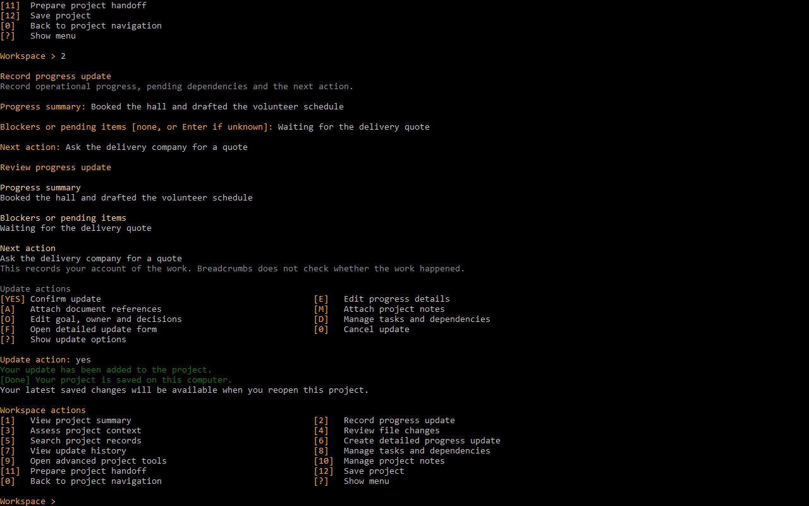
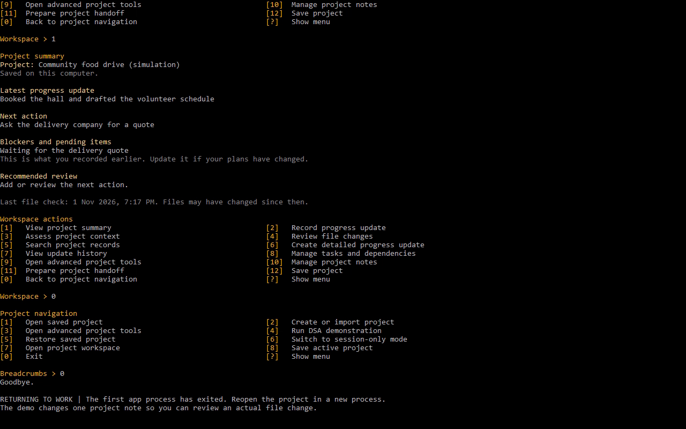
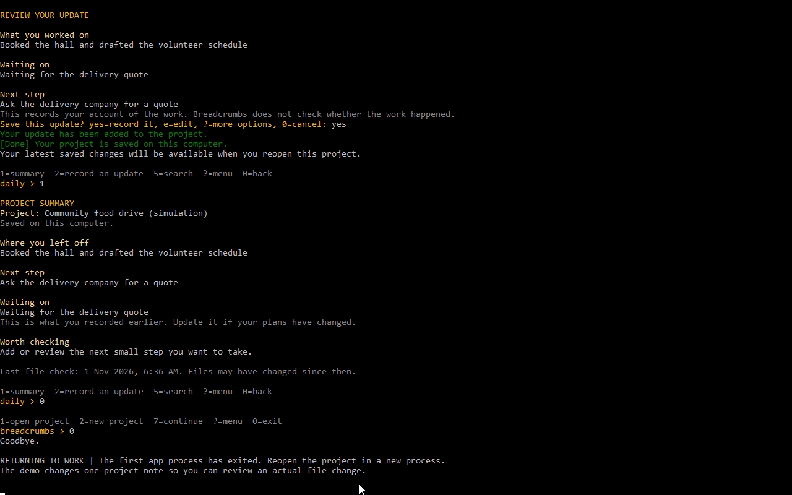
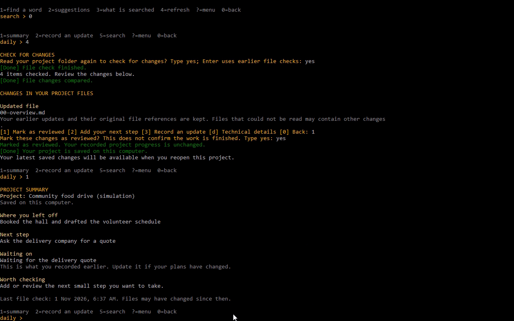
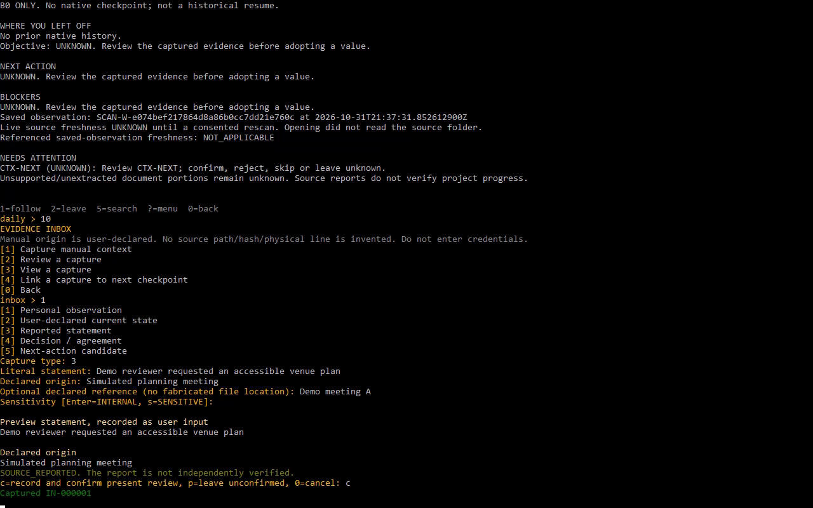

# B7 final implementation and acceptance record

## Result and evidence boundary

B7A–B7E implementation is DEMO_READY for the exercised Windows/JDK25 scope,
targeting Java17. This is not final owner/instructor acceptance or a release.
The B1–B6 behavioral checks remain. Presentation literals have been migrated to
the owner's approved wording, as listed in the current follow-up below. Canonical chronology/provenance,
recovery, daily capture/resume, manual Inbox, generated/portable documents and
bounded DOCX capture all run through production CLI/services. No merge, deployment,
private-document discovery or package installation occurred in the implementation.
The separately requested earlier Discord summary was posted and read back; this
presentation follow-up sends no new Discord message.

`REAL_DOCUMENT_ACCEPTANCE = PARTIAL_PUBLIC_DOCX; FULL_MATRIX_PENDING_OWNER_REVIEW`

## Current universal Project Map and initial review

The previous first-import preview exposed individual source records without a
short account of the actual project context. The new overview shows supported
goal, documented current state, next action, important uncertainty and coverage
before B0 confirmation. It offers individual source review, a universal
eight-section map, proposed present-context clarification, confirmation and cancel.
Draft assessments use existing ContextReview semantics only after explicit B0
confirmation. No initial checkpoint is created; saving remains separate consent.

Returning workspace option 13 derives the same map from current canonical
records, original B0, later observations, historical checkpoints, current reviews,
eligible manual context, explicit Graph tasks/edges and existing audit/freshness.
Opening it never scans files. Fileless projects use supplied context and can
record/save/reopen updates. Source task candidates, user assessments and historical
work remain distinct. PDF/XLSX/PPTX bodies, private notes and excluded names remain
outside the new display. Actual extracted DOCX paragraphs retain their locators.
No parser, canonical schema, fifth DSA or second handoff generator was added.

Implementation commits: 9fe697b (typed bounded projection), 4ef73fd (CLI and
production scenarios) and e121d75 (field-limit correction). Final Windows gate
`build/b7e-verification-1ec0d658dade4926825118c6e7937cf5` passed on 1 November
2026, 22:18:00–22:21:40 Asia/Manila: exit 0; all 157 source/test/script hashes
unchanged. It includes all B1–B7 groups, interrupted-process recovery, existing
four-profile Main scenarios, six new Project Map Main scenarios, native junction/
ACL checks and the unrelated-cwd path-with-spaces launcher. New view checks cover
28/40/80/120/160 columns in color/plain output, C/R/U, proposed clarification,
cancellation including /cancel, offline reopening, all map sections, paging,
source groups, note display consent, DOCX/capacity limits and canonical byte
immutability. No old state/effect assertions were removed.

Final video confirmation exposed an unrelated document-text cap generating
unnecessary warnings for complete overview fields. Cap notices now consult only
the relevant categories, with a new UI regression. The final gate supersedes
the earlier passed `build/b7e-verification-3a06728e97774d04be3d3ff15dd6210f`.

The first full gate failed because a new progress-document fixture triggered the
existing notes-mode prompt, shifting its scripted inputs. That failed receipt is
retained locally at `build/b7e-verification-e5d0c0a5a2ff4705aafae576c95058dd`.
The corrected runner preserves clean-exit and saved-state checks. Actual native
inspection also found composed history separators rendered as question marks;
the new display boundary now preserves readable line breaks while sanitizing
terminal controls. See the [implementation guide](B7_PROJECT_MAP_AND_ONBOARDING.md),
[execution record](B7_EXECPLAN.md) and [current evidence](evidence/b7/e/project-map/README.md).

The final native capture is 332.667 seconds at 1280x800/24fps, using a populated
62-paragraph synthetic project in two production ProjectConsole processes. Five
unaltered frames were visually inspected: approved brand, initial overview,
original source links, separated history and returning-session freshness. Full
decode passed without errors. All 169 application classes and 157 gate inputs
match; canonical readback confirms the expected update/note/observation/review,
and all 12 saved file paths/bytes remain unchanged. The MP4 is local at
`build/b7-project-map-delivery-4a0023a07e87410db3562c1e99c84117/walkthrough.mp4`.
Only sanitized transcripts, screenshots and reproducibility metadata are committed.

This is scripted developer inspection, not independent participant feedback.
Actual JDK17, Unix/instructor hardware, full representative-document acceptance
and owner visual acceptance remain open. The earlier professional-navigation
record below is retained as historical evidence; the Project Map gate supersedes
its source/test counts for the current implementation.

## Current professional navigation correction

The owner requested professional simple language, consistent capitalization,
ordered choices and reliable discoverability. Primary menus now use specific
action labels in sentence case. Existing numeric routes appear in numeric order.
Full and compact views share one action definition, and every available menu key
stays visible after a result. Wide layouts use aligned columns; narrow layouts
use wrapped lists. Update confirmation explicitly lists every accepted action.
Prompts are separated from results and ordinary words are no longer split.

Home option 8 and workspace option 12 expose Save directly. Enabling local saving there also
governs subsequent updates because the workspace reads ProjectConsole's current
save mode. Search returns to its actual previous menu, and View search coverage
shows observed project counts and limits rather than generic instructions alone.
All existing functions, canonical data, privacy controls, B3 art and animation remain.

Final gate `build/b7e-verification-d7884c85436240c8a9fbffa4422342ac` passed on
1 November 2026, 19:17–19:19 Asia/Manila: exit 0, 149 inputs unchanged. All B1–B7,
separate-process scenarios, native junction/ACL checks and space-path launcher
passed. ProfessionalNavigationTest verifies post-result action visibility/order,
confirmation keys, explicit-save persistence, actual coverage and plain/color
wrapping at 28/40/80/120 columns. The failing reproduction is preserved in commit
ec371dd. Copy assertions were updated without dropping state/effect checks.

The updated native walkthrough is 210 seconds, H264, 1280x800 at 24 fps, 19,751,964 bytes.
It runs production ProjectConsole in two Java processes with a populated simulated
project and scripted input. Preflight rejects any selected primary menu key that
was not displayed immediately beforehand. Full FFmpeg decode passed; real frames
at 3/55/75/165/200 seconds were inspected. All 150 recorded application class hashes
match the final build. Saved-state readback confirms the expected update, reported
note, observation and review, with every stored byte unchanged by inspection.

Local video:
`C:/Users/Papa/Desktop/Knowledgebase/Projects/Breadcrumbs/build/b7-professional-demo-6a2760a2a8074f36af2f0daf7a32ebc2/walkthrough.mp4`.
SHA256 `9ee26838f2782ea407c23da2235c054dcd8ba87cc9b20c31f4a8f0a9b5c13688`.
See [gate summary](evidence/b7/e/professional/summary.txt),
[test results](evidence/b7/e/professional/tests.txt),
[recording identity](evidence/b7/e/professional/recording-identity.json) and
[saved-state readback](evidence/b7/e/professional/native-readback.txt).

Specification self-review PASS and engineering-quality self-review PASS for this
bounded correction. This is DEMO_READY on Windows/JDK25 targeting Java17.
Owner visual acceptance, actual JDK17 and the full representative-file matrix
remain open. No independent review, merge, release or new Discord write is claimed.
This recording supersedes the earlier walkthroughs below.





## Earlier plain-language follow-up and populated demo

The owner approved everyday language and reassuring animation without removing
functions. Ordinary screens now show a project summary, progress updates, notes,
next step, waiting-on and readable save outcomes. Advanced tools retain IDs,
original detailed reports, hashes, DSA diagnostics and all numerical routes.
The B3 artwork and grouped 120 ms intro are unchanged. Operation feedback uses
one breathing-dot row with actual counts and a written final result. Fast work
is never delayed for animation.

Final native gate: `build/b7e-verification-6bc4819fd2e3438da38410716c13f727`,
1 November 2026, 06:36–06:39 Asia/Manila. Exit 0, 148 source/test/script/launcher
inputs unchanged. All B1–B7 and separate-process scenarios passed, including
native Windows junction/ACL boundaries and the space-path launcher. Developer
Python caches are now excluded from input enumeration. See the
[gate summary](evidence/b7/e/beginner/summary.txt),
[test results](evidence/b7/e/beginner/tests.txt) and
[input hashes](evidence/b7/e/beginner/source-sha256.txt).

The new 150.25-second MP4 records actual production ProjectConsole in two native
Java processes with paced scripted Reader input. It is an explicitly simulated
community food drive: a populated 62-paragraph Word plan and coordination files,
four readable source files, 101 captured context entries and no prior session.
It demonstrates import, a confirmed update, save, process exit/reopen, reported
meeting note with separate permissions, search, one real fixture file change,
scoped review and a standalone handoff folder. It does not verify real events.

Local video:
`C:/Users/Papa/Desktop/Knowledgebase/Projects/Breadcrumbs/build/b7-beginner-demo-8d5582ea8f624b929e610137138b06c6/walkthrough.mp4`.
H264, 1280x800, 24 fps, 16,430,022 bytes. SHA256
`12d75861e03e044fd3a67f0988ceecb7beb4b8a4475269daf1472fed5fcd1209`.
FFmpeg decoded the full video with exit 0. Actual frames at 3, 50, 105, 125 and
143 seconds were inspected for branding, spacing, readable flow and real outputs.
All 150 recorded application class hashes match the final gate build. Original
fixture bytes remain unchanged except the explicitly scripted overview-note edit.
Saved-state readback confirms one update, one reported note, one later observation
and one scoped review; every stored file's byte hash is unchanged by readback.
See [recording identity](evidence/b7/e/beginner/recording-identity.json) and
[readback](evidence/b7/e/beginner/native-readback.txt).

One failed native attempt exposed CRLF pause values in the capture harness.
That attempt was stopped and retained locally, and is not delivery evidence.
Pause validation now happens before console navigation. The successful capture
and final regression exercise the corrected harness source. Product operations
have no artificial timing changes. Raw video and generated project files stay local.

Copy-only migrations cover B3 project/startup, B4 review/process, B5 graph-save,
B6 switch markers, and B7 workflow/Inbox/recovery/feedback tests. Detailed drift
assertions explicitly choose `d` and then acknowledge the same observation.
Canonical counts, references, fault checks, privacy, DSA and old-format assertions
remain. New tests exercise plain wording, source-versus-owner meaning, missing
details, narrow rendering, successful restart and save-versus-handoff failures.
The Frozen Master/First-Import contracts are unchanged.

Specification self-review PASS for the approved presentation scope. Engineering
quality self-review PASS for the existing architecture, bounded feedback, explicit
state ownership and verified failure behavior. These are single-owner verdicts.
Owner visual acceptance, independent review, actual Java17 and the full real-file
matrix remain open. Implementation is DEMO_READY within the stated Windows/JDK25
scope. This recording supersedes the earlier template walkthrough below.
Implementation/evidence commit `00bbfda` is pushed to open, unmerged
[PR12](https://github.com/jieuneun1999/Breadcrumbs/pull/12), retaining the B7D base.





The owner's additional authorization permitted a substantial public download.
The90,770-byte [Government of Northwest Territories project-plan template](https://www.fin.gov.nt.ca/en/resources/project-management-plan-template)
has453 main-document paragraphs and no Breadcrumbs session. Exact source URL:
https://www.fin.gov.nt.ca/sites/fin/files/project_management_plan.docx.
SHA256: `437972d69ad2e86137e62f9551689ec7247a253dacff83b11ad54645d2ea92c0`.
An independently inspected paragraph154 was captured exactly, explicitly reviewed,
searched, linked to a checkpoint, saved/restarted and rehashed unchanged. Six
public-DOCX assertions passed. Capture is partial at200total claims; field instructions
and cached TOC text are omitted. A template's instructions/placeholder text are
source data, never evidence that the user performed that work.

The [W3C dummy PDF](https://www.w3.org/WAI/ER/tests/xhtml/testfiles/resources/pdf/dummy.pdf)
is13,264bytes, SHA256
`3df79d34abbca99308e79cb94461c1893582604d68329a41fd4bec1885e6adb4`.
It is discovered/fingerprinted only. No PDF body-extraction claim is made. A small
public python-docx paragraph fixture was also checked locally; it does not replace
representative real-document acceptance. Downloaded originals remain under ignored
build folders and are not committed or redistributed as application source.

The public sample does not close actual TXT/Markdown/CSV/XLSX/PPTX/other-format
representative-file gates or owner review. Those formats have synthetic coverage
and truthful metadata boundaries as documented in the compatibility matrix.
No private directory was searched and no real private content was uploaded.

## Final native regression

Command: `pwsh -NoProfile -File scripts/verify-b7-stage.ps1 -Stage B7E -NativeWindows`.
Final accepted run:2026-11-01 05:39:00–05:40:53 Asia/Manila, Windows10,
actual JDK25, Java17 target. Exit0;147 observed source/test/script/launcher input hashes
match before/after. See [summary](evidence/b7/e/summary.txt),
[tests](evidence/b7/e/tests.txt), [inputs](evidence/b7/e/source-sha256.txt) and
[external space-path launcher](evidence/b7/e/launcher.txt). These are LF/trailing
whitespace-normalized review copies; raw logs remain in the named build run.

Observed groups include B1 DLL3721/CLI59; B2 inspector91/bootstrap62/CLI39;
B3 storage65/CLI73/presentation153; B4 187; B5 1090; B6 231; B7A69,
B7B43, B7C47 and B7D58 assertions, plus shared terminal/narrow/privacy checks.
Separate Main-process scenarios pass: B7 four profiles56, B6 21, B5 10 and B4 55,
plus real interrupted-Java recovery. Dynamic output assertions vary with bounded
presentation rows; no old test expectation was weakened. A full aggregate count
is not inferred from partially overlapping runner reports.

The native gate creates real junction fixtures, exercises source/storage/export
guards and existing ACL negatives, plus an unrelated-working-directory launcher
from a runnable folder and storage path containing spaces. Native sharing-lock
tests prove bounded publication recovery/failure. Actual Java17 runtime is absent;
`--release17` on JDK25 is not treated as that execution evidence. Unix, symbolic-link
creation and instructor hardware remain NOT_PROVEN.

## Expected versus observed workflow matrix

| Scenario | Expected | Observed evidence |
| --- | --- | --- |
| A Academic | Import notes/Word/PDF, B0, checkpoint, audit/search/handoff with honest gaps | ACADEMIC Main processes pass; real DOCX parser, PDF metadata negative, generated health/handoff, restart. Public DOCX separately checked. |
| B Software | Explicit dependencies/checkpoint, external change, consented scan, drift/search/resume | SOFTWARE Main processes pass; original source statements stay independently unverified. B6 regression also covers metadata-only source/schema formats. |
| C Operations | CSV/notes, decisions/owners, explicit relationships, nontechnical handoff | OPERATIONS Main processes pass; CSV configured fields and explicit two-item dependency survive restart/package. |
| D Personal/unstructured | Useful without a codebase, manual Inbox and quick checkpoint | NEW_EMPTY production-console test passes capture -> permissions -> manual link -> checkpoint -> package -> restart/search. GENERAL Main runner also passes. |
| E Leave/return | Two checkpoints, saved/generative state and restart agree | Four-profile process runner creates exactly two native checkpoints across processes; read-back canonical count and standalone docs checked. |
| F Interrupted save | Explicit recovery, no silent rollback | Fault seams plus Runtime.halt child process, restart detection, candidate validation and exact recovery acknowledgement pass. |
| G Modified source | Preserve old references, show current hash/freshness | Actual external fixture edit/rescan yields MODIFIED and referenced STALE; old checkpoint observation/IDs remain unchanged. |
| H Search | Exact/prefix, locators, invalidation, isolation, rebuild | Original B6 suites/processes plus Inbox and DOCX tests pass; unsupported-only terms absent; no default snippets/unreviewed verification. |
| I Missing optional libraries | Core operates without document dependencies | All production/process runs use only compiled core/JDK classes. PDF/XLSX/PPTX remain unavailable metadata-only. Actual JDK17 execution remains pending. |
| J Portable handoff | Read standalone, selected archives, no source copies/absolute-root leaks | Artifact and Main tests pass consent/create-only/selected summaries, privacy, read-back and canonical-save/export-failure separation. |

## Terminal, branding and recording

The owner's polished B3 logo is the sole production logo. ReferenceBrandArt remains byte-for-byte unchanged from the accepted B6 baseline.
RichBrandRenderer buffers the same completed B3 frame and adds a short grouped intro.
Production automatically uses that exact transcription at160columns; monochrome
uses its same marks. Narrow layouts use a plain text label rather than alternate
artwork. The historical renderer API remains solely for frozen B3 fixture tests;
production has no calls to it. Exact-match and narrow-no-alternate assertions pass.

Shared colors/feedback and their compatibility limits are described in
[B7 Terminal Experience](B7_TERMINAL_EXPERIENCE.md). The first120-column native
recording was superseded after the owner's explicit branding clarification.
The delivery recording uses the approved160-column brand and actual Main output.
Inputs are scripted, simulated meeting notes are labeled, downloaded originals are
unchanged, and Java's piped-input start/final fallback is stated explicitly.
The final MP4 is native window capture of production ProjectConsole in two Java
processes, with a paced scripted Reader and real process-local VT support. The
separate Main-process HTML replay uses piped input/static fallback and is a
readable transcript, not desktop evidence. Recording artifact verification and paths are appended below.

## Review and delivery checklist

Specification self-review PASS for the implemented bounded contract: one canonical
owner, B0/history distinction, immutable provenance, explicit mutations/consent,
saved/export failure separation, truthful partial/unsupported coverage and the
owner's preserved logo. Engineering-quality self-review PASS with known bounds:
small package-owned services, no new graded DSA, no parser dependency, original
tests retained, controlled failure tests and real-process verification. These are
single-owner reviews, not independent peer/model/instructor approval.

- [x] Complete JDK-only source, Windows launcher and compilation instructions.
- [x] B7 recovery, daily workflows, Inbox, documents/packages and bounded DOCX.
- [x] Four-DSA API/complexity table and classroom demonstration procedure.
- [x] Four-profile process scenarios, original regression and native path checks.
- [x] Source/license inventory, security/privacy summary and document matrix.
- [x] Expected/observed tests and real public-DOCX bounded acceptance evidence.
- [x] Approved B3 branding and shared terminal/fallback tests.
- [x] Final recording visual inspection and artifact reconciliation.
- [ ] Owner review of full representative-format document matrix.
- [ ] Actual Java17 runtime, Unix/instructor hardware and independent review.
- [ ] Owner RELEASE choice and separately authorized merge/release actions.

Owner next choices remain CONTINUE / CHANGE / RELEASE / STOP. A release choice
would still require the exact protected effects; it does not silently merge or
publish anything. Safe implementation is delivered separately from those gates.

## Earlier template recording and reconciled source

The final native MP4 is 87.333333 seconds, H264,1280x800 at 24 fps,18,366,806 bytes.
SHA256: `a2ca1613e80cc7d2fb553c207ba06ed342cc18ce2519d15efc2c59b5bb0bfe4d`.
It was decoded end-to-end with FFmpeg, exit0. Native frames at 2.27/2.40 seconds
visually show the grouped loaf and completed wordmark;3/28/60-second frames show
launch, spaced Inbox and actual process restart. All 145 recorded application
class hashes match the final compiled gate. The completed color/monochrome brand
output also matches the original accepted renderer bytes exactly; see
[brand identity](evidence/b7/e/brand-identity.txt) and
[recording identity](evidence/b7/e/recording-identity.txt).

Local video: `C:\Users\Papa\Desktop\Knowledgebase\Projects\Breadcrumbs\build\b7-calm-native-a3dc2b81b53041b8a5950772fcb3d247/walkthrough.mp4`.
The separate readable Main replay is under
`build/b7-calm-readable-dry-76f3f3d71c81412aa618051b981eb657/walkthrough.html`.
These recordings supersede the earlier crowded/character-flushed captures.
Public originals and video remain local, outside the committed source/evidence.
Only synthetic-interface/redacted native captures and validation metadata are
committed. Downloaded DOCX/PDF hashes remain unchanged. Capture pacing belongs to
the developer Reader, not product operations. Automatic capability detection in
all terminal hosts, owner visual approval and broader file-format acceptance are
not inferred from this controlled native capture.

Source-bound final gate:

```text
B7E | Started 2026-11-01T05:39:00.3284046+08:00 | Completed 2026-11-01T05:40:53.3821425+08:00
OS Microsoft Windows NT 10.0.19045.0
Exit 0 | 147 input hashes unchanged
NativeWindows=True | junctions/ACL and unrelated-cwd space-path launcher exercised only when True
```

The input enumeration includes local developer capture-cache files when present;
the 147 count describes this observed run, not a promised count for every clone.
No application inputs changed during the run. Final docs/evidence edits follow
that gate and do not change the compiled application classes.




## Stacked implementation delivery

| Stage | Verified implementation head | Open PR / base |
| --- | --- | --- |
| A Recovery | 3f6130e | [#8](https://github.com/jieuneun1999/Breadcrumbs/pull/8), B6 |
| B Daily workflows | 915995f | [#9](https://github.com/jieuneun1999/Breadcrumbs/pull/9), B7A |
| C Inbox/artifacts | d640f53 | [#10](https://github.com/jieuneun1999/Breadcrumbs/pull/10), B7B |
| D DOCX/coverage | da972f3 | [#11](https://github.com/jieuneun1999/Breadcrumbs/pull/11), B7C |
| E Integration/terminal/acceptance | b8be509 | [#12](https://github.com/jieuneun1999/Breadcrumbs/pull/12), B7D |

The E head above identifies the compiled implementation/evidence commit; the
subsequent receipt commit updates execution records only. All stages remain open,
unmerged review work. At that earlier checkpoint, Frozen Master/First-Import contracts and every old B1–B6 test
body were compared against B6 and were unchanged. The later UI-copy migrations
are listed in the current follow-up above. Earlier branch evidence stays
available. No merge/release/deployment or external Discord communication occurred.


## Final screen UX refinement — 15 November 2026

Review candidate on `codex/breadcrumbs-session`, based on `352f3df`. The owner
authorized committing/pushing this snapshot for assessment on 15 November 2026.
The separate Windows launcher checkout remains at `ee01d61`. Current changes are
not published to [PR12](https://github.com/jieuneun1999/Breadcrumbs/pull/12), which
was read back OPEN and unmerged. No merge/release is authorized by this result.

The owner rejected the small workspace portrait. All active portraits now scale
the same original64x22 bread:56x20 in roomy viewports,48x17 or40x14 as space permits.
Home and workspace use the same size rules; task mood changes expression/motion.
The former28x10 variant is not selected. Original B3 brand/reference arrays,
canonical services, storage and four custom DSA implementations are unchanged.

TerminalScreenManager stages existing output until an input boundary, replaces
one alternate viewport, pages reports and restores the original screen on close.
BreadSupport coordinates native input, active region and motion. Numeric choices
retain their meanings; arrows plus Enter resolve to the same action tokens.
Enter alone never confirms an action. Partial text is preserved and free text is
static. `--no-animation` keeps replacement/arrows; `--no-mascot` keeps navigation;
`--classic-ui` and capability/no-color/redirection fallbacks remain available.
The B3 two-part intro is live, never replayed inside report pages. Header scans
last about105ms. Native ticks remain125ms; idle accents change about375ms and sway
about500ms, replacing long unchanged holds. Operations are never artificially delayed.

| Evidence | Observed result |
| --- | --- |
| `build/bread-cmd-7078d75981094dc4b5620645e5c68cee` | PASS: all B1-B7 groups/process scenarios, report failure/resize tests and exact isolated production launcher |
| `build/bread-cmd-6ec48a4625d645d1a6dd0f084a52d03f` | Native screen/input/save/restart/cleanup PASS with explicit host limits |
| `build/final-capture-6ec48a46` | Same compiled build; actual55.875s1280x832 H264,1326 frames, full decode and inspected output |
| Reconciliation |169 unchanged inputs;186 matching Java classes; one saved progress update, exact next action and unchanged saved-file bytes |

The demo uses a synthetic project without files. It demonstrates Home, setup,
overview, workspace, Project Map, explicit technical detail, update/save, exit,
and a second process reopening saved context with reduced motion. Scripted native
key injection is developer evidence, not independent participant/human typing.
Reading pauses are in the driver. The earlier low-frame-rate final capture and
occluded CopyFromScreen screenshots are not visual motion acceptance evidence.

The Windows review copy is `build/final-terminal-ux-2026-11-15-7078d759/` and contains
one named MP4, two actual decoded frames, probe and README. No private data or
external upload. Full reproduction/hashes remain in the source worktree's build.

DEMO_READY for this bounded Windows/JDK25 exercise, targetingJava17. Actual
JDK17, Unix, Windows Terminal, VS Code, Ctrl+C/independent keyboard, owner visual
approval and live80-column host resize remain NOT_PROVEN. This runner also skips
unavailable symbolic-link/junction fixtures; prior results are not new executions.
A resize during report paging safely releases complete content to classic mode;
ordinary menu resize stops stale motion and refreshes on the next response/`?`.
Specification and engineering-quality self-reviews pass within these boundaries;
no independent-review or RELEASE_READY claim. See B7_EXECPLAN for repairs and limits.


## Latest unified-experience follow-up

The current local follow-up supersedes the earlier separate-intro/header-scan and
shared-size descriptions above. See BREADCRUMBS_UNIFIED_EXPERIENCE_POLISH.md for
complete design, responsive decisions and scope.


## Final executed acceptance (15 November 2026)

DEMO_READY for bounded Windows/JDK25, targeting Java17. The implementation remains
local on codex/breadcrumbs-session above fcbef69. Owner visual approval is pending.
No new commit, push, PR12 update, merge, release or external publication occurred.

| Receipt | Fresh observed result |
| --- | --- |
| build/bread-cmd-da0354e4fcd849a5ae4c901bc153cd3c | PASS: complete B1-B7 groups, separate-process scenarios and exact isolated run.bat/build.bat launcher |
| build/bread-cmd-a2537eea1f21484db6e458226833a8c1 | PASS: native Home/partial input/static fields/arrows/Map/save/exit plus actual80x24 restart with reduced motion |
| build/bread-cmd-e358150f444440549ac087fa0dbd06b8 | PASS: final stable160x52 recording, same navigation/save/restart checks, restored terminal |
| Source reconciliation | All173 executable/test/tool inputs and190 Java classes match across the three runs and the final tree |
| Canonical readback | One actual progress update; exact next action Confirm volunteer shifts before Friday; all8 saved files unchanged by read-only loading |
| Approved identity | Every22-row native B3 output matches the unchanged approved renderer; no cropped lettering or Home scroll |
| Media | Actual83.083s1280x832 H264,1989frames/about23.94fps; full decode PASS; Home/gaze/detail/form/save/reopen frames inspected |

The Windows review copy is
C:/Users/Papa/Desktop/Knowledgebase/Projects/Breadcrumbs/build/unified-experience-2026-11-15-e358150f/.
It contains one named MP4, three decoded checkpoints and verification metadata.
The video uses believable synthetic context and scripted native keys. It does not
claim independent human usability validation. Earlier attempts and occluded screen
copies are intermediate records, not the final visual receipt.

Specification self-review: PASS within exercised scope. One opening composition,
exact original identity, complete actions, meaningful transitions, stable fields,
docked responsive bread, coherent eyes, professional existing routes and unchanged
canonical services are covered by source inspection, viewport/gaze assertions and
the native run. The owner-reported disappearance/empty-space and missing-font
issues are explicitly covered. Engineering-quality self-review: PASS within scope;
one render/input owner, bounded capture/cache, clean scheduler/cursor lifecycle,
complete fallbacks and source-bound regression/native evidence. These are separate
single-owner verdicts, not independent reviews. Final Impeccable detect exited0
with no output; Java coverage is not inferred from that result.

Live80-column resize while in the alternate buffer remains NOT_PROVEN because the
host retained160. This differs from the actual80x24 restarted process that passed.
Actual JDK17 runtime, Linux JVM, Windows Terminal, VS Code, independent human input,
Ctrl+C and owner artistic acceptance remain open. Junction fixtures unavailable to
the runner were skipped, not passed. No RELEASE_READY claim. The owner may CONTINUE,
CHANGE, RELEASE or STOP; any protected effect still needs its exact authorized scope.


## Main publication completed (15 November 2026)

Owner-authorized integration PR13 merged to main at
b000b2a3046b0551e1852a307fed23b424e48fe2, with server-enforced expected head
7c54c8938fb7e88297103437db38b6cf9c09ef1d. Immediate GitHub readback confirms base
main, merged state, both expected parents and tree
a989b656c6d7199741f65778e2052c3ffff25571 equal to the reviewed candidate.
GitHub also confirms PRs1 through12 closed with non-null merged_at timestamps.
Their heads were preserved, retargeted to main without rewriting, and incorporated
by the consolidation merge. No open item remains in the frozen13-PR queue.

Independent read-only Terra verdict: PASS+NOTES at C2 above. Fresh native evidence
build/bread-cmd-0a8441a1ddae455bb504bbfc81602ed0 passed actual160x52 B3 Home, numbered
and arrow routes, paused partial/freeform input, Map, save/restart, cleanup and
reduced motion. All173 current inputs match that fresh run. All190 Java class
hashes equal the full B1-B7/process/launcher receipt da0354e4. Full-suite application
evidence is reused by exact byte identity; only the C# native-driver assertion
changed after that full run, and the new native run compiles/exercises it.

The120x30 reviewer attempt exposed the unconditional full-logo test precondition,
not an application regression. One harness-only correction now requires the full
B3 art when it actually fits and otherwise verifies compact branding while marking
full-art acceptance NOT_PROVEN for that run. The earlier83-second recording still
shows the exact same application Java bytes. Its historical173-input equality
predates this single harness change; do not claim that old driver hash is current.

There are zero configured GitHub check runs/statuses. Local regression and the
fresh independent native run are the verification evidence, not a CI claim.
Specification and quality review found no material correctness, security, privacy,
storage or custom-DSA defect. Comment review recorded zero material MUST KILL flags.
No additional application edits or style churn were made during publication.

Code is now published to main under the owner's exact authorization. Application
readiness remains DEMO_READY for the exercised Windows/JDK25 scope targetingJava17.
Live80-column alternate-buffer resize, human usability/Ctrl+C, other terminals and
actual JDK17 runtime plus owner artistic acceptance remain open. No tag, release,
deployment, force push, rebase, branch deletion or external team message occurred.
The primary Windows launcher checkout remains untouched on its existing branch;
the Orca source worktree advances normally to the merged history. A documentation-
only receipt commit follows this merge; it leaves all173 executable inputs intact.
