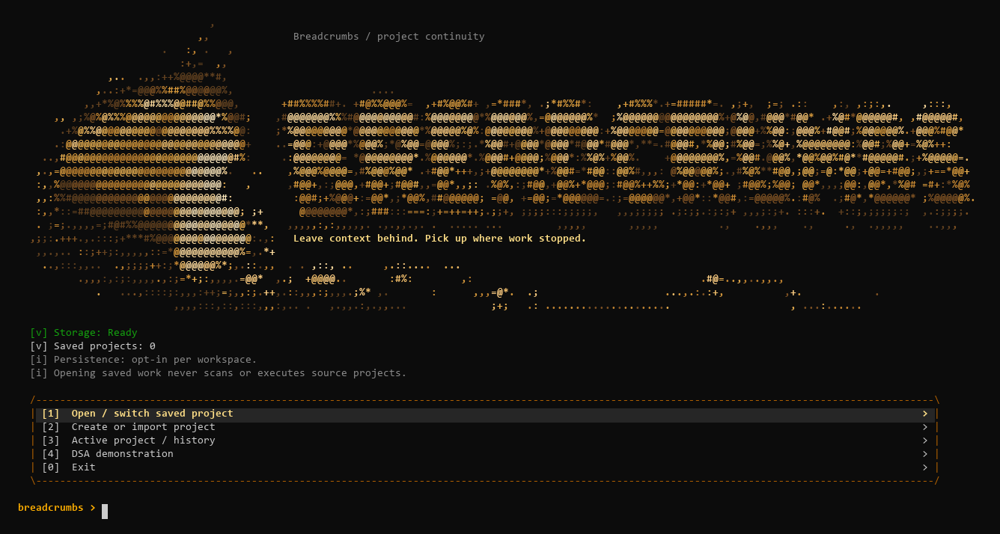
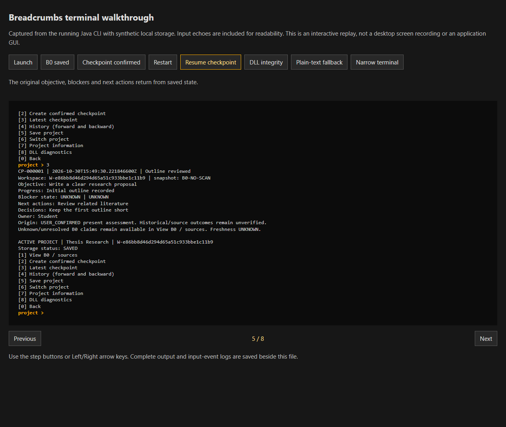
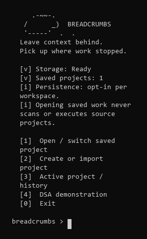

# Breadcrumbs terminal visual checkpoint

The owner accepted this version for saving and PR review on 2026-10-31.
Further visual refinement remains possible. This is not release acceptance.

These artifacts come from the real Java CLI capture on 2026-10-30 at
`build/launch-walkthrough/f6adcfe0a7a54644b203535d000e531a`.
The capture uses disposable synthetic storage. No source screenshot, real
workspace file or user project data is included here.

- [Launch](launch.png) renders the actual 160-column ANSI output as a PNG.
- [Restored checkpoint](resume-replay.png) is a browser screenshot of the
  captured CLI replay, including CP-000001 and the restored next action.
- [Narrow fallback](narrow.png) renders actual 30-column no-color output.
- [Standalone replay](walkthrough.html) contains all eight captured states.
  Download it and open it locally. It needs no server or external assets.
- [Artifact SHA-256](sha256.txt) records the copied files' hashes.

The PNG previews are not native Windows Terminal screenshots. The replay adds
input echoes and navigation controls for review; those controls are not part of
the Java application. Counts, checkpoint confirmation and restart state come
from actual Java processes. The sample title is synthetic.
The published HTML normalizes CRLF to LF and changes the footer's log-location
sentence. Its captured frames, colors and navigation behavior are unchanged. Complete raw
stdout and input-event logs remain in the original local capture folder.

The app prints fixed ASCII characters with ANSI lighting bands. It loads no
image or font. The approved reference supplies the loaf and beveled wordmark
shape; its sample status, version and browser chrome are excluded. Detailed art
needs `--rich-brand`, color and at least 160 requested columns. Normal, narrow
and no-color output retain the compact ASCII fallback.

The [execution record](../../B3_EXECUTION.md) preserves commands, scope and
limitations. The [original source manifest](../terminal-visual-source-sha256.txt)
binds the 2026-10-30 capture and tests to their source. All 53 input hashes matched
before publication cleanup. Scoped LF normalization then fixed three files and
the recipe's newline handling. All 53 compiled application class hashes stayed
identical, preserving the captured behavior and artwork.

The fresh 2026-10-31 Windows check passes 4,263 assertions with both junction
fixtures and all 15 separate-process scenarios. See the
[publication source manifest](../terminal-visual-publication-source-sha256.txt),
[Windows results](../terminal-visual-publication-windows-summary.txt) and
[bytecode and recipe checks](../terminal-visual-publication-bytecode.txt).
